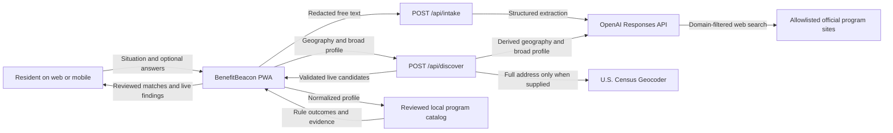
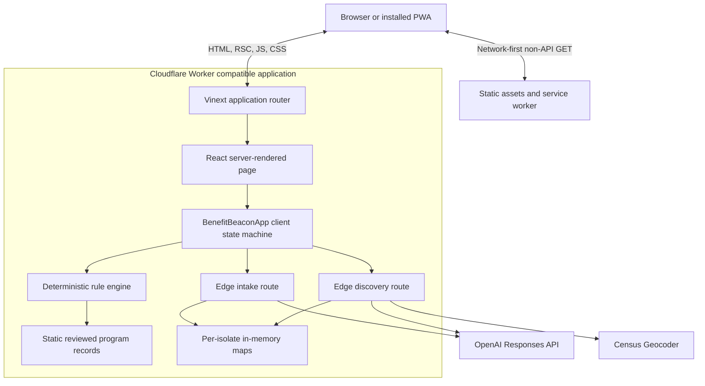
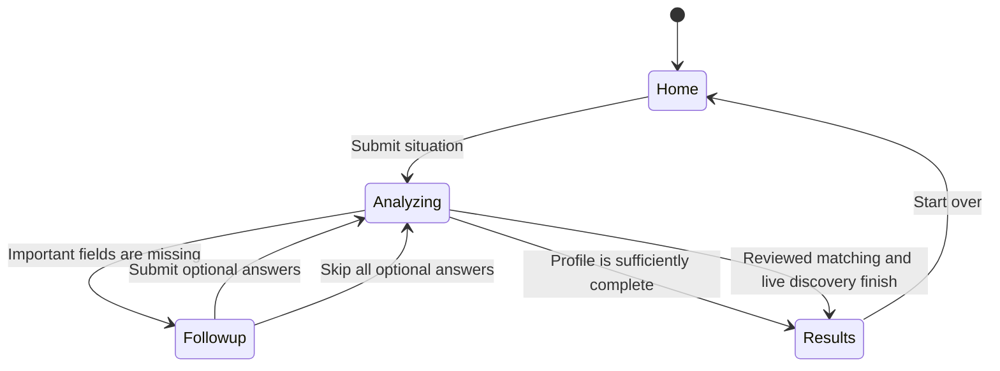
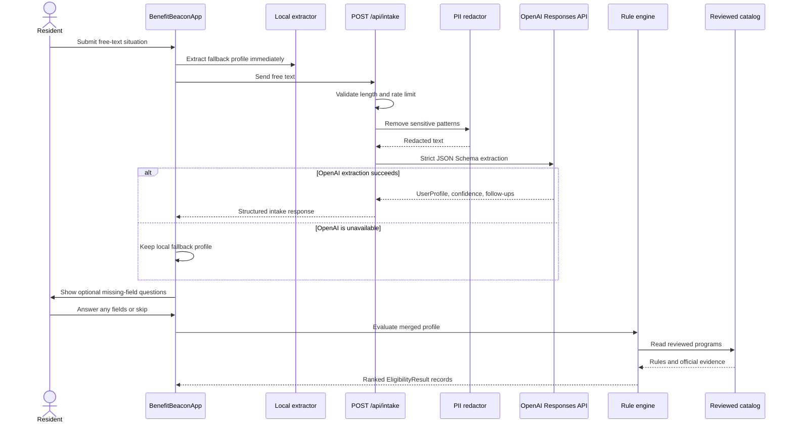
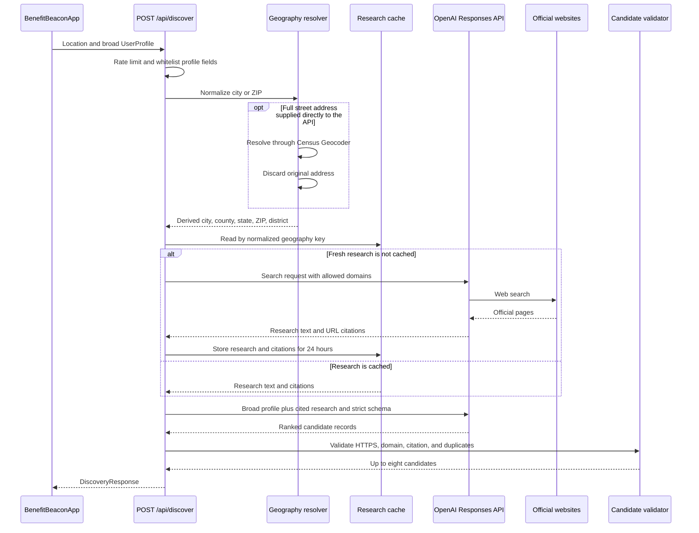
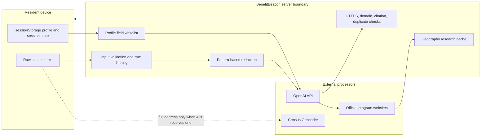

# BenefitBeacon Architecture and Technical Design

**Status:** Implemented local application  
**Version:** 1.0  
**Updated:** October 8, 2026  
**Primary scope:** Sunnyvale, Santa Clara County, California, and federal benefit programs

## 1. Purpose and architectural position

BenefitBeacon is a responsive benefits-navigation application that turns one free-text description into a structured resident profile, asks optional questions for missing high-value facts, and produces a final list from two intentionally separate sources:

1. **Reviewed programs** are evaluated by deterministic, testable eligibility rules and receive `likely`, `maybe`, or `unlikely` statuses.
2. **Live discoveries** are found from allowlisted official websites and ranked for relevance by an LLM. They remain `unverified` and never receive an eligibility determination.

The central architecture decision is that AI may extract, search, summarize, and rank, but it may not make an authoritative eligibility decision. Eligibility estimates for reviewed programs come only from the local rule engine. Final eligibility always belongs to the administering agency.

## 2. System context



## 3. Runtime and deployment architecture



The application uses Next.js-compatible App Router conventions, React 19, TypeScript, Vinext, Vite, and the Cloudflare Vite plugin. The worker entry point delegates ordinary requests to the Vinext router and supports Cloudflare image transformation when requested.

Current hosting configuration does not enable D1 or R2. The database scaffolding exists but is not part of the active request path. Resident profiles are not stored in a server database.

## 4. Source layout and component responsibilities

| Component | Location | Responsibility |
|---|---|---|
| Application page | `app/page.tsx` | Mounts the BenefitBeacon client application. |
| Client experience | `components/BenefitBeaconApp.tsx` | Controls home, analysis, optional follow-up, and result states; merges optional answers; invokes APIs; evaluates reviewed programs; renders results. |
| Intake API | `app/api/intake/route.ts` | Validates and rate-limits free text, redacts sensitive patterns, calls Structured Outputs, and returns a constrained `UserProfile`. |
| Discovery API | `app/api/discover/route.ts` | Normalizes geography, searches official sources, performs profile-aware extraction, validates citations and URLs, deduplicates candidates, and returns live findings. |
| Local extractor | `lib/intake/local-extractor.ts` | Provides a no-model fallback for common location, age, income, household, housing, military, employment, utility, and interest signals. |
| PII redactor | `lib/privacy/redact.ts` | Removes SSNs, likely account/card numbers, email addresses, phone numbers, and common street-address patterns before hosted intake. |
| Rule engine | `lib/rules/engine.ts` | Evaluates declarative program rules, calculates status and score, and returns an auditable rule trace. |
| Discovery validation | `lib/discovery.ts` | Resolves local geography conventions, enforces the domain allowlist and HTTPS, cleans URLs, validates citations, and removes duplicates. |
| Program catalog | `data/programs.ts` | Stores ten reviewed city, county, state, and federal program records with sources, rules, steps, and verification dates. |
| Shared contracts | `lib/types.ts` | Defines resident profiles, reviewed programs, rules, results, geography, live candidates, and API responses. |
| Service worker | `public/sw.js` | Provides network-first caching for non-API GET requests and an offline application-shell fallback. |
| Worker entry | `worker/index.ts` | Connects the built application to the Cloudflare Worker runtime. |
| Tests | `tests/` | Covers rule operators, deterministic ranking, discovery privacy and URL controls, SSR output, and PWA metadata. |

## 5. Client interaction flow

The client is a small state machine with four views: `home`, `analyzing`, `followup`, and `results`.



The initial screen intentionally presents one main text area and one primary action. After extraction, the application asks only about missing fields that can improve reviewed or live matching. Every field can remain blank, and the entire follow-up step can be skipped.

Follow-up fields can include:

- city, state, or ZIP;
- age range and household size;
- broad household income band;
- housing and children in the household;
- employment, Veteran, and active-duty status;
- disability and caregiver status;
- utility-bill pressure and home age;
- assistance interests such as food, health, housing, utilities, child care, transportation, home repair, and employment.

## 6. End-to-end request flow

### 6.1 Intake and reviewed matching



The client creates a local fallback before calling the server. If hosted intake fails, the resident can still continue through optional questions and reviewed matching.

### 6.2 Live official-source discovery



An uncached discovery makes two Responses API calls: one domain-filtered web search and one structured ranking call. A cached geography reuses the search research and makes only the structured ranking call. Intake is a separate Responses API call, so a complete uncached session normally uses three model calls.

## 7. AI responsibilities and constraints

### 7.1 Intake extraction

The intake model defaults to `gpt-6-luna` with low reasoning effort. It receives redacted free text and must return a strict object in which every schema property is present but may be `null`. The server strips `null` values before returning the profile.

The intake model may:

- normalize explicitly stated information;
- map exact age and income statements to broad bands;
- report extraction confidence;
- suggest up to three useful follow-up questions.

It may not:

- infer sensitive traits or unstated conditions;
- decide benefit eligibility;
- return arbitrary fields outside the schema.

### 7.2 Live search and ranking

The discovery model defaults to `OPENAI_DISCOVERY_MODEL`, falling back to `OPENAI_MODEL` and then `gpt-6-luna`.

The first discovery call searches only allowlisted public-agency and program domains. The second call receives:

- derived geography;
- a whitelisted broad resident profile;
- the research text;
- the search citation URLs.

It returns a strict list of up to eight candidate programs with a relevance reason and relevance score. The score is a ranking signal, not an eligibility probability.

### 7.3 Deterministic eligibility boundary

Only reviewed `Program` records can enter the rule engine. A live result cannot receive `likely`, `maybe`, or `unlikely` until it is reviewed and converted into a curated program record with explicit rules and evidence.

## 8. Rule engine design

Each reviewed program declares three optional rule groups:

- `all`: every rule must pass;
- `any`: at least one rule must pass;
- `not`: no rule may pass.

Supported operators are `eq`, `in`, `in_list`, `gte`, `lte`, and `between`. Each evaluation produces `pass`, `fail`, or `unknown`.

Status calculation is deterministic:

| Condition | Status |
|---|---|
| An `all` rule fails, every `any` rule fails, or a `not` rule passes | `unlikely` |
| No decisive failure exists but required evidence is missing | `maybe` |
| Required conditions are supported without missing decisive evidence | `likely` |

Ranking combines the program's manually assigned impact score, the status weight, and rule coverage. The result also contains `matchedRules`, `failedRules`, and `missingInfo`, enabling the UI to display an eligibility trace.

## 9. Core data contracts

### 9.1 UserProfile

`UserProfile` stores broad, optional fields rather than exact documents or account identifiers. Its main categories are:

| Category | Fields |
|---|---|
| Geography | `zip`, `city`, `state` |
| Household | `ageRange`, `householdSize`, `childrenAges` |
| Financial and housing | `incomeBand`, `housing`, `homeAgeYears`, `hasHighWaterBill` |
| Status | `veteran`, `activeDuty`, `disabled`, `caregiver`, `employment` |
| Preferences | `interests`, `language` |

### 9.2 Reviewed Program

A reviewed program contains identity, jurisdiction, category, summary, benefit, declarative eligibility rules, application steps, an official source, a source excerpt, a verification date, and an impact score.

### 9.3 EligibilityResult

An eligibility result contains the reviewed program, deterministic status, numeric ranking score, matched rules, failed rules, and missing information.

### 9.4 DiscoveredProgram

A live candidate contains program details, published eligibility text, official source and application URLs, source evidence, a relevance reason, a relevance score, discovery time, and the fixed status `unverified`.

## 10. API contracts

### 10.1 POST /api/intake

Request:

```json
{
  "text": "I am retired, rent in Sunnyvale, and need help with utility bills."
}
```

Constraints:

- text length must be between 8 and 2,000 characters;
- maximum 12 requests per 60 seconds per derived client identifier and runtime isolate;
- the API key remains server-side.

Success response:

```json
{
  "profile": {
    "city": "sunnyvale",
    "state": "CA",
    "housing": "rent",
    "employment": "retired",
    "hasHighWaterBill": true
  },
  "confidence": 0.93,
  "followUpQuestions": [
    "What is your age range?",
    "What is your broad household income range?"
  ],
  "mode": "openai",
  "model": "gpt-6-luna",
  "redacted": false
}
```

### 10.2 POST /api/discover

Request:

```json
{
  "location": "Sunnyvale, CA",
  "profile": {
    "city": "sunnyvale",
    "state": "CA",
    "ageRange": "65plus",
    "incomeBand": "25-50k",
    "housing": "rent",
    "veteran": true,
    "interests": ["utilities", "health"]
  }
}
```

Constraints:

- location is limited to 180 normalized characters;
- maximum 6 requests per 60 seconds per derived client identifier and runtime isolate;
- only recognized `UserProfile` fields are forwarded;
- candidate count is capped at eight;
- URLs must use HTTPS and match an allowlisted host.

Success response shape:

```json
{
  "geography": {
    "label": "Sunnyvale, Santa Clara County, CA",
    "city": "Sunnyvale",
    "county": "Santa Clara County",
    "state": "California",
    "stateCode": "CA"
  },
  "candidates": [],
  "mode": "openai",
  "model": "gpt-6-luna",
  "searchedAt": "2026-10-08T21:09:21.470Z",
  "cacheKey": "sunnyvale|santa-clara-county|ca",
  "cached": false,
  "addressDiscarded": false
}
```

## 11. Discovery validation pipeline

Live candidates pass through the following controls before reaching the client:

1. Reject incomplete candidates without a name, source URL, summary, or published eligibility text.
2. Require HTTPS.
3. Require an exact allowlisted hostname or a subdomain of an allowlisted hostname.
4. Require supporting search citations. The current validator accepts the exact cited URL or another URL on a cited host.
5. Remove `utm_*` parameters and fragments.
6. Replace an invalid application URL with the validated source URL.
7. Remove programs already represented by a reviewed name or source/application URL.
8. Remove duplicates within the response.
9. Sort by relevance score and return at most eight records.

The domain allowlist includes relevant municipal, Santa Clara County, California, and federal domains. City-specific domains are prioritized when the city is known.

## 12. Privacy, trust boundaries, and security



Security controls currently implemented:

- no resident account or server-side profile database;
- server-side API key usage only;
- server-side free-text redaction before hosted intake;
- strict Structured Outputs for both model extraction paths;
- input length limits and per-isolate rate limiting;
- broad value bands rather than exact income or age storage;
- original free-text story excluded from discovery requests;
- official-domain filtering during web search;
- post-model HTTPS, hostname, citation, and duplicate validation;
- API requests excluded from service-worker caching;
- live results visibly marked for eligibility confirmation.

The raw story and normalized session data can exist in browser memory, and the final profile and story are stored in `sessionStorage` for the browser session. The application does not intentionally log intake or address text.

## 13. Caching and persistence

| Data | Storage | Lifetime | Key |
|---|---|---|---|
| Resident session | Browser `sessionStorage` | Browser session | `benefitbeacon-session` |
| Official search research | Edge process `Map` | Up to 24 hours or process eviction | Normalized city, county, state, and ZIP |
| Rate-limit counters | Edge process `Map` | 60-second window or process eviction | Client-derived address header |
| PWA shell | Browser Cache Storage | Until service-worker cache replacement | Request URL |
| Reviewed program records | Application bundle | Build lifetime | Program ID |

The discovery cache stores research and citation URLs, not resident profiles. Because the cache is in memory, it is isolated to a runtime instance, not durable, and not guaranteed to be shared across Cloudflare isolates.

## 14. Resilience and failure behavior

The application is designed to preserve reviewed matching when optional network capabilities fail.

| Failure | Behavior |
|---|---|
| Hosted intake fails | Continue with the local extractor and optional follow-up form. |
| No location supplied | Skip live discovery and show reviewed matches. |
| Census cannot resolve an address | Return a location-specific error and suggest city/state or ZIP. |
| OpenAI key missing or rejected | Return an actionable configuration error. |
| Model or web-search access denied | Return an access-specific error. |
| Provider rate or usage limit | Return HTTP 429 with a billing/limit message. |
| Live research or extraction fails | Show reviewed matches and a non-blocking live-search message. |
| Invalid or uncited candidate | Drop it before the response. |
| Network unavailable after installation | Serve the cached non-API application shell; network APIs remain unavailable. |

## 15. Progressive web application behavior

The application manifest enables standalone installation and defines BenefitBeacon branding. The service worker uses a network-first strategy for non-API GET requests:

1. fetch the current resource from the network;
2. cache a successful copy;
3. if the network fails, return the cached request;
4. if the exact request is absent, return the cached root application shell.

API requests are deliberately excluded to prevent benefit profiles or provider responses from entering the service-worker cache.

## 16. Configuration

Server-side environment variables:

| Variable | Required | Purpose |
|---|---|---|
| `OPENAI_API_KEY` | For hosted AI features | Authenticates server-to-server Responses API calls. |
| `OPENAI_MODEL` | Optional | Intake model; defaults to `gpt-6-luna`. |
| `OPENAI_DISCOVERY_MODEL` | Optional | Discovery model; falls back to `OPENAI_MODEL`, then `gpt-6-luna`. |

Secrets belong in `.env.local` for local development and must not be committed or placed in browser code.

## 17. Testing and verification

The current test suite runs after a production build and covers:

- all deterministic rule operators;
- representative reviewed-program ranking;
- official source and verification-date presence;
- Census geography normalization without retaining the street address;
- geography-only cache keys;
- HTTPS and hostname allowlisting, including lookalike-host rejection;
- candidate citation requirements and deduplication;
- server-rendered product content;
- PWA and social metadata.

Commands:

```bash
npm run lint
npm test
```

Live provider tests are intentionally separate from the deterministic unit suite because they require credentials, external network access, and variable provider output.

## 18. Performance and cost profile

The main latency path is external AI and web search rather than local rules. Rule evaluation is synchronous over ten in-bundle program records.

Expected model calls per completed session:

| Scenario | Intake | Web search | Structured live ranking | Total |
|---|---:|---:|---:|---:|
| Complete profile, uncached geography | 1 | 1 | 1 | 3 |
| Complete profile, cached geography | 1 | 0 | 1 | 2 |
| Hosted intake fails, uncached geography | 0 successful | 1 | 1 | 2 successful |
| No location supplied | 1 attempted | 0 | 0 | 1 attempted |

The 24-hour research cache reduces repeated web-search cost while preserving a fresh profile-aware ranking for each resident.

## 19. Current constraints

- The reviewed catalog contains ten programs and is maintained in TypeScript rather than a content-management workflow.
- Local extraction is intentionally heuristic and most complete for the initial Santa Clara County scope.
- Rate limits and discovery research are process-local rather than globally durable.
- Live source support is limited to the configured domain allowlist.
- Citation validation currently permits another path on a cited hostname; exact claim-to-path verification is a future hardening opportunity.
- There is no administrative review interface for promoting a live candidate into the reviewed catalog.
- There is no persistent audit log, distributed tracing, or provider cost telemetry.
- Offline mode serves the application shell and reviewed client bundle but cannot perform hosted intake or live discovery.

## 20. Recommended production evolution

1. Move reviewed programs to versioned validated records with source sections, effective dates, authors, reviewers, and change history.
2. Add a human review queue for live candidates before they can become reviewed programs.
3. Move rate limiting and research caching to a durable shared edge store.
4. Add structured operational telemetry for latency, provider status, tool usage, token usage, candidate rejection reasons, and cache hit rate without recording resident text.
5. Build a representative evaluation set for extraction accuracy, rule agreement, follow-up usefulness, citation support, and unsupported-claim rate.
6. Add exact citation-to-claim validation and source freshness checks.
7. Add scheduled source-change detection while preserving human approval for rule changes.
8. Add accessibility and mobile browser regression tests for the full optional-question flow.

## 21. Architectural invariants

The following rules should remain true as the system evolves:

- AI output alone never grants or denies eligibility.
- Every reviewed status is reproducible from a versioned profile and rule record.
- Every live program links to a validated official source.
- Missing resident information remains unknown rather than inferred.
- Optional questions remain optional.
- Raw free text is never forwarded to the live discovery ranking step.
- Street addresses are never used as cache keys or sent to OpenAI.
- Failure of live discovery never removes reviewed results.
