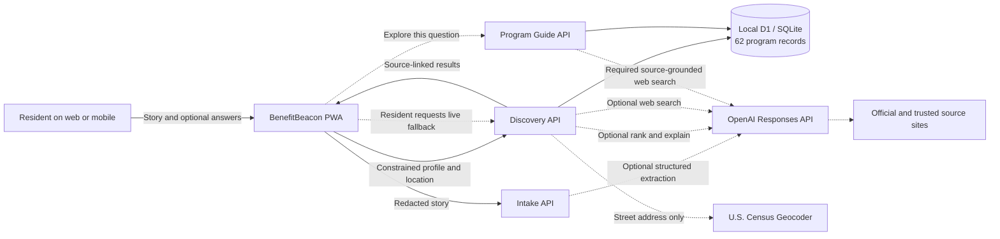
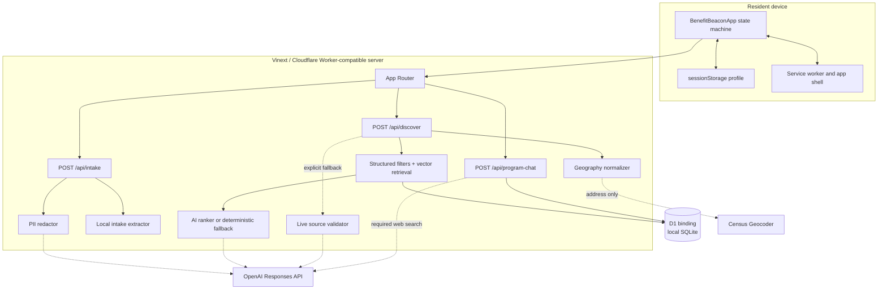
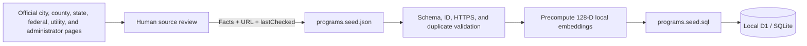
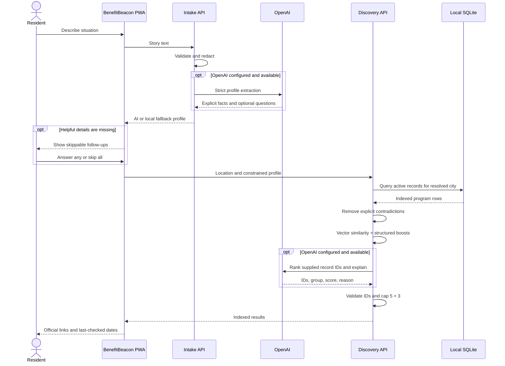
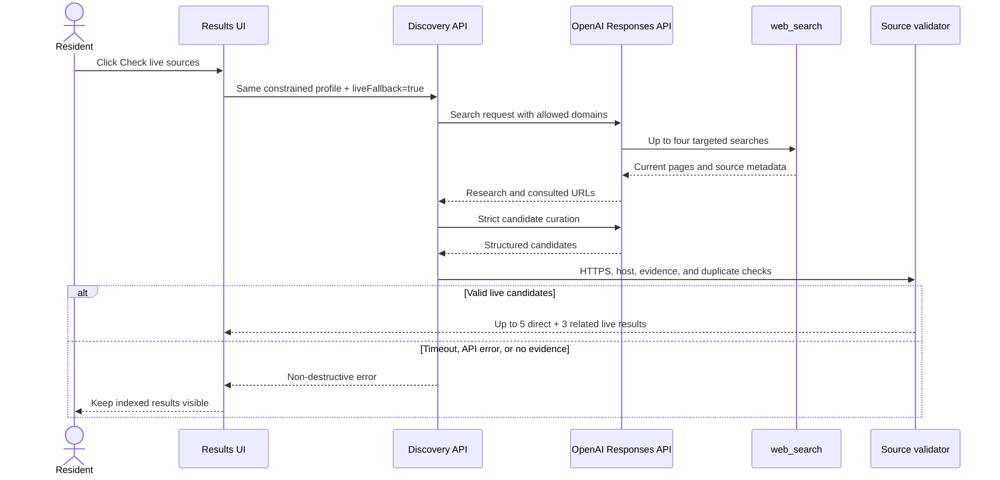
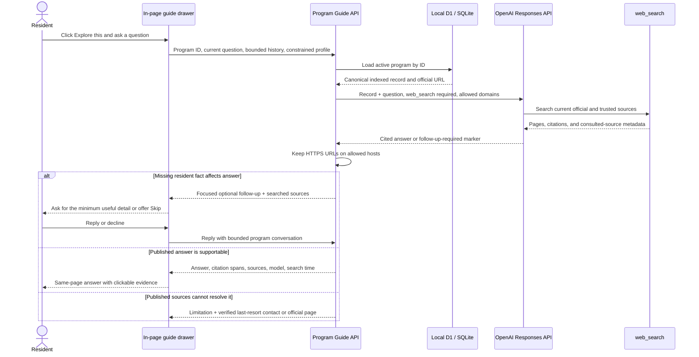
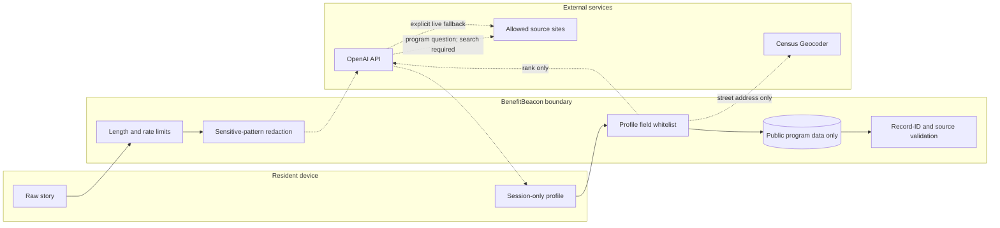

# BenefitBeacon Architecture and Technical Design

**Status:** Implemented local congressional-app demonstration
**Version:** 3.1
**Updated:** October 23, 2026
**Scope:** Sunnyvale, plus applicable county, California, federal, utility, and program-administrator benefits

## 1. Architecture goals

BenefitBeacon is a responsive benefits navigator that turns one plain-language story into a short, source-linked list of programs. Its architecture prioritizes:

- **Demo reliability:** the core result path is local and survives OpenAI or web-search failure.
- **Freshness evidence:** every result retains an official source and `Last checked` date.
- **Conservative AI:** models understand the resident, ask optional questions, rank known records, and explain relevance; they do not invent program facts or decide eligibility.
- **Privacy:** raw stories are redacted before hosted processing, and resident profiles are not persisted server-side.
- **Accessibility:** the same PWA works on desktop and mobile with large type, strong contrast, keyboard support, reduced motion, and optional extra-large text.

The current resident experience exposes 52 records serving Sunnyvale, checked shortly before the presentation. The underlying schema remains ready for future city expansion. A relevance score orders informational leads; the administering program alone determines eligibility.

## 2. System context



Solid arrows form the reliable local path. Dashed arrows are optional network enrichments or narrowly scoped external services.

## 3. Runtime components



The application uses React 19, TypeScript, Next.js-compatible App Router conventions, Vinext, Vite, Wrangler, Cloudflare D1, and SQLite-compatible SQL.

## 4. Component responsibilities

| Component | Location | Responsibility |
|---|---|---|
| Client experience | `components/BenefitBeaconApp.tsx` | Intake, optional follow-ups, grouped results, same-page per-program conversations, explicit live fallback, sharing, printing, and accessibility preferences |
| Intake API | `app/api/intake/route.ts` | Length validation, rate limiting, redaction, strict profile extraction, and follow-up generation |
| Discovery API | `app/api/discover/route.ts` | Geography resolution, indexed retrieval, guarded AI ranking, deterministic fallback, and optional live-search orchestration |
| Program Guide API | `app/api/program-chat/route.ts` | Server-side program lookup, history/profile limits, forced source-grounded web search, citation extraction, source filtering, and rate limiting |
| Indexed retrieval | `lib/indexed-programs.ts` | City-scoped SQL query, contradiction filtering, similarity scoring, structured boosts, and group caps |
| Local embeddings | `lib/local-vector.ts` | Deterministic 128-dimensional feature-hash embedding, synonym expansion, bigrams, normalization, and cosine similarity |
| Source/geography controls | `lib/discovery.ts` | ZIP/city normalization, Census result parsing, allowed domains, cache keys, live-candidate validation, and deduplication |
| Program schema | `db/schema.ts` | SQLite/D1 schema for program facts, targeting fields, vector, source, and freshness metadata |
| Seed builder | `scripts/build-program-seed.ts` | Dataset validation, vector precomputation, and deterministic SQL generation |
| Source dataset | `data/programs.seed.json` | Human-reviewable authoritative program snapshot |
| Database migration | `migrations/0001_program_index.sql` | Programs table and query indexes |
| Shared contracts | `lib/types.ts` | Profile, geography, indexed/live program, and API response types |
| Service worker | `public/sw.js` | Network-first non-API caching and offline shell fallback |

## 5. Data preparation flow

The corpus is curated shortly before the presentation rather than scraped during a resident interaction.



`npm run db:seed` runs this pipeline and loads Wrangler’s local D1 state. The generated SQLite state lives under ignored `.wrangler/`; the reviewed JSON and generated SQL remain reproducible project artifacts.

## 6. Resident request flow



The deterministic route always exists: local extraction, local retrieval, local ordering, and templated explanations.

## 7. Indexed retrieval design

### 7.1 Structured filtering

Hard exclusions are deliberately narrow. A record is removed only when an explicit supplied fact contradicts a requirement, such as a renter requesting an owner-only rebate or an explicit non-veteran profile encountering a veteran-only program. Unknown fields never become negative evidence.

### 7.2 Semantic matching

At seed time, searchable record text is transformed into a normalized 128-dimensional signed feature-hash vector. The same local function embeds the profile and geography at request time. Token synonym expansion and bigrams improve recall for common benefit vocabulary such as utility bills, food support, accessibility, and rebates.

For 62 rows, a JavaScript cosine scan is simpler and more reliable than a vector extension or hosted vector service. It also keeps all normal retrieval offline.

### 7.3 Scoring

The deterministic score combines:

- cosine similarity;
- overlap with explicitly stated need tags;
- audience matches such as senior, homeowner, renter, caregiver, veteran, disability, or household with children;
- jurisdiction preference for local programs;
- a small boost when an income-targeted program matches a supplied non-high income band.

The score is clamped to 1–100 and is used only for ordering.

### 7.4 AI ranking boundary

The ranking call receives a bounded pool of complete indexed records and can return only:

- an existing record ID;
- `direct` or `related`;
- a relevance score;
- a resident-specific explanation.

Unknown IDs are discarded. All program names, descriptions, amounts, eligibility text, official URLs, and freshness dates come from SQLite and cannot be changed by the model.

## 8. Optional live fallback

Live search is a resident-invoked enhancement, not a hidden dependency.



The live research cache lasts up to 24 hours in process and is keyed by normalized geography, sanitized needs, and coarse profile signals—not the raw story.

### Per-program guide flow



The browser keeps a separate in-memory conversation for each opened program so the resident can move between results without losing context. The guide searches before deciding whether it can answer, needs one more resident detail, or must provide a verified handoff. It does not use contact information as a substitute for asking an answerable follow-up. The original free-text story is not sent to this endpoint.

### Guided application extension flow

```mermaid
sequenceDiagram
    actor Resident
    participant WebApp as BenefitBeacon web app
    participant Bridge as Extension handoff bridge
    participant Panel as Browser side panel
    participant Form as Official application page
    participant API as Program Guide API

    Resident->>WebApp: Choose Apply with BenefitBeacon
    WebApp->>Bridge: Selected record, coarse profile, bounded conversation
    Bridge->>Panel: Store local application session
    WebApp->>Form: Open official application URL
    Resident->>Panel: Open extension and approve this site
    Panel->>Form: Scan visible labels, options, required flags, completion state
    Form-->>Panel: Structure only; no entered values
    Resident->>Panel: Highlight, ask, or approve one safe suggestion
    opt Ask about a field
        Panel->>API: Program context and question
        API-->>Panel: Source-grounded guidance
    end
    opt Approve a safe suggestion
        Panel->>Form: Fill the selected non-sensitive field
        Form-->>Resident: Resident reviews and continues manually
    end
```

The Manifest V3 extension uses a side panel, a narrow handoff content script on BenefitBeacon, and an on-demand form guide injected only after the resident grants access to the active official site. The guide can highlight visible fields and fill only a small deterministic allowlist of coarse profile facts. It blocks sensitive identifiers and file inputs, never reads entered values beyond an empty/non-empty completion flag, and has no submit, signature, consent, verification-bypass, or navigation command.

## 9. Data contracts

### UserProfile

Broad optional fields include city, state, ZIP, age range, household size, children’s age bands, income band, housing, military connection, disability, caregiver status, employment, home age, utility pressure, interests, and language.

### Program record

An indexed program contains identity, jurisdiction, city scope, category, summary, benefit, published eligibility text, application link, source link, source evidence, matching tags, structured restrictions, vector, freshness date, and active status.

### DiscoveryResponse

The API returns derived geography, candidates, response mode (`indexed`, `indexed-ai`, or `live-fallback`), optional model, request timestamp, normalized cache key, address-discarded flag, indexed-row count, and whether live fallback is available.

## 10. Privacy and trust boundaries



Key invariants:

- API keys remain server-side.
- The discovery route never receives the original story.
- Street addresses are sent only to Census and discarded after geography resolution.
- Resident profiles are not stored in SQLite.
- Missing resident information stays unknown rather than inferred.
- AI output never grants or denies eligibility.
- Every displayed record retains a source and freshness date.
- Program-guide answers can cite only HTTPS pages on the selected or approved domains.

## 11. Persistence and caching

| Data | Storage | Lifetime |
|---|---|---|
| Authoritative program snapshot | Project JSON and generated SQL | Until reviewed refresh |
| Local program database | Wrangler D1 / SQLite under `.wrangler/` | Until reseeded or local state removed |
| Resident profile | Browser `sessionStorage` | Browser session |
| Optional live research | Edge-process `Map` | Up to 24 hours or process eviction |
| Per-program conversation | Browser memory | Current page session; cleared on start over or reload |
| Rate counters | Edge-process `Map` | 60 seconds or process eviction |
| PWA shell | Browser Cache Storage | Until service-worker replacement |

## 12. Failure behavior

| Failure | Behavior |
|---|---|
| OpenAI intake failure | Continue with local extraction and optional questions |
| OpenAI ranking failure or timeout | Continue with deterministic local ranking |
| Missing API key | Core indexed experience remains available |
| Live-search failure | Keep indexed results and show a non-destructive message |
| Program-guide search failure | Keep the drawer open with the indexed summary and direct official source link |
| Unsupported city | Return no indexed rows rather than invent broader coverage |
| Census unavailable | Ask for Sunnyvale or a supported Sunnyvale ZIP |
| Local database absent | Return an operator message to run `npm run db:seed` |
| Invalid or contradictory candidate | Remove it before display |
| Offline device | Load cached application shell; local server APIs still require connectivity to the server |

## 13. Accessibility

The interface includes large default typography, 44–56px controls, semantic landmarks, visible keyboard focus, screen-reader status regions, explicit labels, high-contrast mode, reduced-motion support, responsive reflow, and an extra-large-text option. Follow-ups are optional and skippable, and the initial page retains one primary input and one primary action.

## 14. Configuration

| Variable | Required | Purpose |
|---|---|---|
| `OPENAI_API_KEY` | No | Enables hosted intake, indexed ranking/explanation, explicit live fallback, and per-program source-grounded chat |
| `OPENAI_MODEL` | No | Intake and indexed-ranking model; defaults to `gpt-6-luna` |
| `OPENAI_DISCOVERY_MODEL` | No | Optional override used only by live fallback |
| `OPENAI_PROGRAM_CHAT_MODEL` | No | Optional override for the per-program guide; falls back through discovery and default models |

Secrets belong in `.env.local` and must not be committed.

## 15. Operations and verification

Before the presentation:

1. Re-open high-priority official source pages.
2. Update changed facts, URLs, and `lastChecked` values in `data/programs.seed.json`.
3. Run `npm run db:seed`.
4. Run `npm run lint && npm test`.
5. Exercise multiple Sunnyvale stories, including a supported ZIP-only location and an out-of-scope city rejection.

Automated checks cover dataset count and uniqueness, both-city coverage, HTTPS links, embedding determinism, geography mapping, source validation, rendered accessibility/PWA metadata, and production compilation.

## 16. Current constraints and production path

This design is optimized for a one-time, two-city demonstration. It intentionally does not include an automated crawler, claim-level diffing, historical source snapshots, or a hosted vector database.

A production expansion should add scheduled source-freshness checks, human review queues, exact claim-to-source evidence, durable distributed rate limits, privacy-safe telemetry, broader geographic normalization, and an evaluation set for retrieval and direct/related classification. A hosted vector service becomes useful only after the corpus grows enough that a local scan and SQLite filtering no longer meet latency or operational needs.
