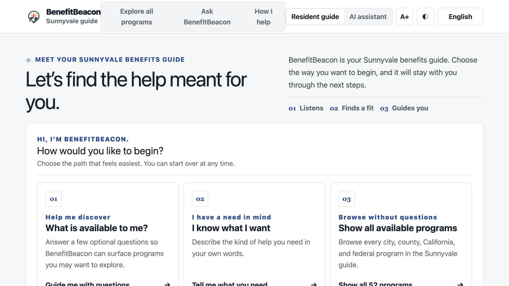
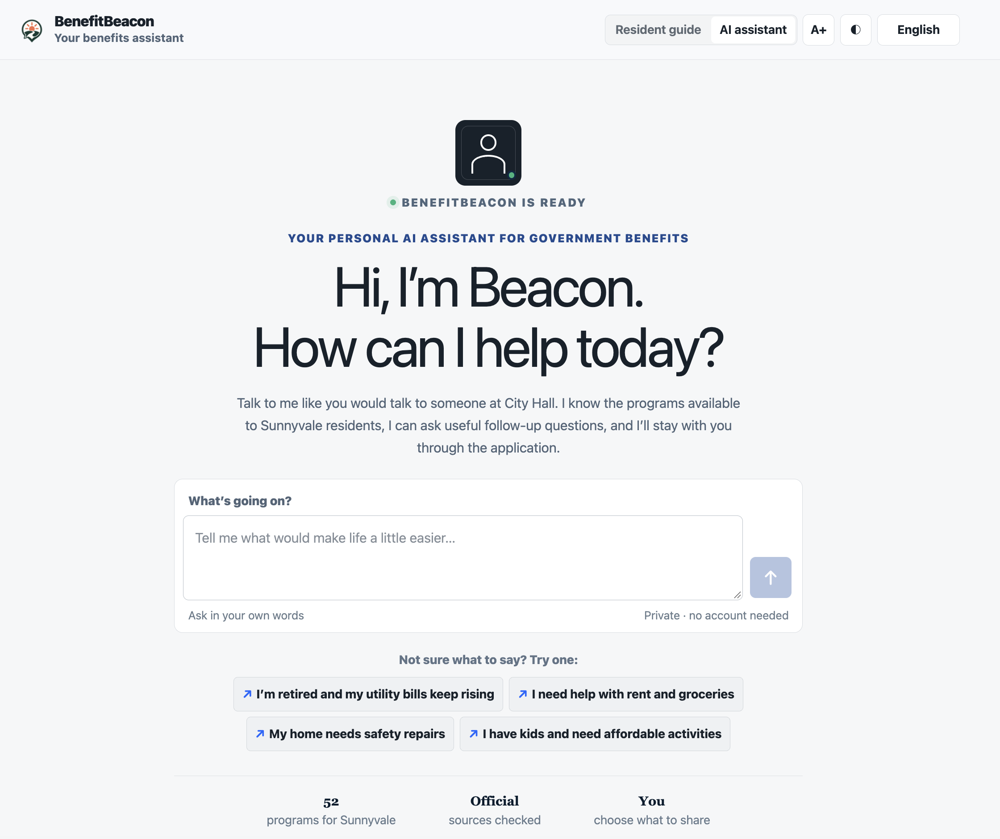
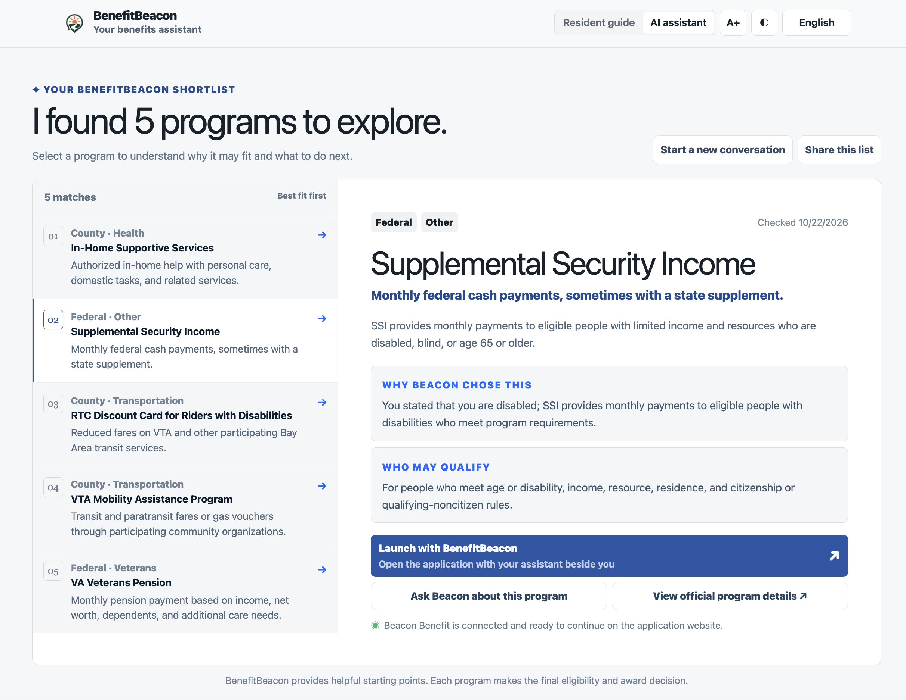
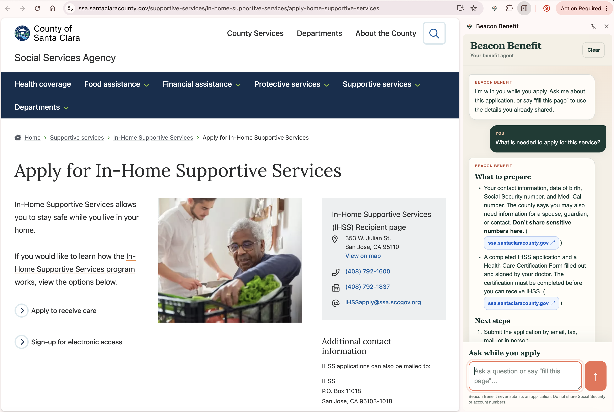

# BenefitBeacon

BenefitBeacon is an AI benefits assistant for Sunnyvale residents. It helps a resident describe what they need, answer optional follow-up questions, discover relevant city, county, California, federal, utility, tax, health, food, housing, disability, senior, family, and prescription-assistance programs, and continue receiving guidance while applying on an official website.

The product is designed around a simple principle: AI may help understand, rank, and explain, but authoritative program records and official sources remain the basis for every result. BenefitBeacon provides informational starting points; each program administrator makes the final eligibility and award decision.



## Product walkthrough

### Start with the AI benefits assistant

Residents can describe their situation in their own words or begin with a sample prompt. They choose what to share, and every follow-up question is optional.



### Review and explore matched programs

The personalized shortlist puts the best matches first. Selecting a program shows its benefit, published eligibility information, relevance explanation, source freshness, and clear actions for asking questions or continuing to the official application.



### Continue with Beacon Benefit while applying

The browser extension stays beside the official program website, uses the current page as context, presents sourced answers in a readable format, and can prepare resident-reviewed suggestions for safe empty fields.



## Current resident experience

The header includes a two-option experience switch. Both experiences use the same program catalog, matching system, privacy rules, and application guide.

### Resident Guide

The guide presents three equal primary actions:

1. **What is available to me?** — starts a guided conversation with one optional question at a time.
2. **I know what I want** — accepts a plain-language request such as “I’m retired and my utility bills keep rising.”
3. **Show all available programs** — opens the complete Sunnyvale catalog without asking for personal details.

The guide also includes a prominent four-step progress display while it interprets the request and checks programs.

### AI Assistant

The alternate experience presents Beacon as a personal benefits AI assistant. A resident can enter a request, choose a sample prompt, skip any follow-up question, and ask to see results at any time. Results appear in a program list with the selected program’s explanation and next actions in a detail panel.

The follow-up conversation automatically keeps the active question and answer controls in view, including on smaller screens.

### Results and program guidance

BenefitBeacon currently exposes **programs that serve Sunnyvale residents**. Results combine city, Santa Clara County and regional, California, federal, regulated-utility, and direct program-administrator programs.

For a targeted search, the system returns:

- up to five direct matches;
- up to three additional programs worth knowing about;
- a plain-language reason each program may matter;
- published eligibility information;
- the official source, application link, and `Last checked` date.

Selecting **Explore this** opens a clean, same-page conversation for that program. The resident can ask about eligibility, documents, deadlines, costs, application steps, or confusing terms. The guide searches current official sources for each substantive answer, displays readable citations and source buttons, and asks one focused optional question when another resident fact is necessary. It does not list facts the resident has not shared.

Selecting **Apply with BenefitBeacon** opens the official application and hands the selected program, safe profile facts, and recent program conversation to the optional Beacon Benefit browser extension.

## Beacon Benefit browser extension

Beacon Benefit is a Chrome and Microsoft Edge Manifest V3 side-panel extension. Its interface is intentionally limited to the conversation, an **Ask while you apply** input, and a **Clear** action.

When opened beside an application, the extension captures safe page context—including the current URL without query parameters, page title, visible instructions, headings, links, and empty field labels—so the assistant can answer questions about the application currently on screen. Answers support concise headings, lists, descriptive hyperlinks, and clean source call-to-action buttons instead of exposing long raw URLs.

A resident may also type **fill this page**. BenefitBeacon then:

1. scans only empty, non-sensitive fields;
2. sends field labels, allowed options, and safe facts already shared by the resident to the server;
3. returns only direct matches with at least 82% confidence;
4. shows the proposed values for review;
5. fills them only after the resident explicitly approves.

The extension never reads or transmits values already entered into form controls. It never fills sensitive identifiers, exact birth dates, bank information, signatures, attestations, protected demographic fields, or uploads. It never submits a form, accepts terms, bypasses verification, or advances an application automatically.

See [extension/README.md](./extension/README.md) for installation and detailed safety boundaries.

## How matching works

The normal discovery path is local-first and does not depend on live web search:

1. Resolve the experience to Sunnyvale, California.
2. Query active Sunnyvale-serving records from local Cloudflare D1/SQLite.
3. Remove records contradicted by facts the resident explicitly supplied.
4. Compute semantic similarity with deterministic 128-dimensional local embeddings.
5. Add structured boosts for needs, audience, jurisdiction, and income targeting.
6. Build a bounded candidate pool.
7. When OpenAI is configured, allow the model to reorder only those candidate IDs and write grounded explanations.
8. Fall back to deterministic ordering and templated explanations if the model is unavailable.

The score is a ranking signal, not an eligibility probability. AI cannot add a program, URL, benefit amount, deadline, or eligibility rule to the indexed result set.

## Program catalog

`data/programs.seed.json` is the curated source of truth. It currently contains 62 records:

- 52 records serve Sunnyvale and are visible in the current application;
- 10 records are Cupertino-only and remain in the data set for possible future expansion;
- shared regional, state, and federal records may include both cities in their scope.

Every active record includes structured program details, an authoritative source URL, an application URL, a source excerpt, a freshness date, matching tags, applicable eligibility constraints, and a precomputed embedding. Cupertino-only records are not returned by the current Sunnyvale experience.

## AI calls and boundaries

All OpenAI calls use the server-side [Responses API](https://platform.openai.com/docs/api-reference/responses). `OPENAI_API_KEY` is never bundled into the web client or extension.

| Call | Trigger | Purpose | Fallback or limit |
|---|---|---|---|
| Intake extraction | A resident submits a free-text situation | Extract explicit profile facts and suggest useful optional questions | Local deterministic extraction |
| Indexed ranking | Local retrieval produces a candidate pool | Reorder supplied record IDs and explain relevance | Deterministic hybrid ranking |
| Live discovery | The resident selects **Check for updates** | Search allowlisted official domains for current programs | Existing indexed results remain available |
| Program guide | The resident asks about a selected program or application | Search current sources, answer, cite, or ask one optional follow-up | Official program details and links remain available |
| Form assistance | The resident requests **fill this page** | Map explicit safe profile facts to empty, non-sensitive fields | No fields are changed |

Before hosted intake, BenefitBeacon redacts common sensitive identifiers, email addresses, phone numbers, and street-address patterns. The live discovery endpoint receives a constrained profile and derived geography rather than the resident’s original story.

## Technology

- React 19 and TypeScript
- Next.js 16 application structure running through Vinext/Vite
- Cloudflare Workers runtime and Wrangler
- Cloudflare D1/SQLite with Drizzle ORM
- Deterministic 128-dimensional local embeddings
- OpenAI Responses API with web search for source-grounded guidance
- Chrome/Edge Manifest V3 side-panel extension
- Progressive Web App manifest and service worker

## Run locally

Requirements:

- Node.js 22.13 or newer
- npm

Install, configure, seed the local database, and start the app:

```bash
npm ci
cp .env.example .env.local
npm run db:seed
npm run dev
```

Open [http://localhost:3000](http://localhost:3000).

`OPENAI_API_KEY` is optional for the core indexed experience. Without it, intake extraction and program ranking use their local fallbacks; live discovery, source-grounded program chat, and AI form suggestions are unavailable.

### Environment variables

```dotenv
OPENAI_API_KEY=
OPENAI_MODEL=gpt-6-luna
OPENAI_DISCOVERY_MODEL=gpt-6-luna
OPENAI_PROGRAM_CHAT_MODEL=gpt-6-luna
OPENAI_FORM_MODEL=gpt-6-luna
```

- `OPENAI_MODEL` controls structured intake and indexed-record ranking.
- `OPENAI_DISCOVERY_MODEL` optionally overrides the model used by live discovery.
- `OPENAI_PROGRAM_CHAT_MODEL` optionally overrides the source-grounded program and application guide.
- `OPENAI_FORM_MODEL` optionally overrides safe form-field matching.

The latter three fall back to `OPENAI_MODEL` when omitted. Model identifiers are configurable so deployments can select models that have been tested for their cost, latency, and accuracy requirements.

### Load the extension locally

1. Keep BenefitBeacon running at `http://localhost:3000`.
2. Open `chrome://extensions` or `edge://extensions`.
3. Enable **Developer mode**.
4. Select **Load unpacked** and choose the repository’s `extension` directory.
5. Pin **Beacon Benefit** to the toolbar.
6. Use **Apply with BenefitBeacon** from a program result, then open the extension beside the application.

The extension requests access to an external application origin only when the resident chooses to connect that site.

## Refresh the catalog

1. Verify every changed program against its authoritative source.
2. Update `data/programs.seed.json`, including `lastChecked`.
3. Rebuild and seed the local index:

   ```bash
   npm run db:seed
   ```

4. Run project verification:

   ```bash
   npm run lint
   npm test
   ```

`npm run db:seed` validates the JSON records, generates deterministic embeddings and SQL, applies the schema, and loads Wrangler’s local D1 database. Local database files are stored under the ignored `.wrangler/` directory.

## Accessibility and privacy

- English, Spanish, and Vietnamese interface copy and follow-up questions
- Keyboard navigation, visible focus, semantic landmarks, and a skip link
- Focus trapping and Escape-to-close behavior in the program guide
- Large touch targets, extra-large-text mode, high-contrast mode, and reduced-motion support
- Responsive layouts for mobile, tablet, and desktop
- No resident account or server-side resident profile database
- Resident profile and handoff state kept in browser session or extension storage
- No automatic application submission or final eligibility decision

## Documentation

- [Product requirements](./requirements.md)
- [Architecture and technical design](./ARCHITECTURE_AND_TECHNICAL_DESIGN.md)
- [Technical specification](./BENEFITBEACON_TECHNICAL_SPEC.md)
- [Extension guide](./extension/README.md)

BenefitBeacon provides informational estimates and application assistance, not legal, financial, or case-management advice.
